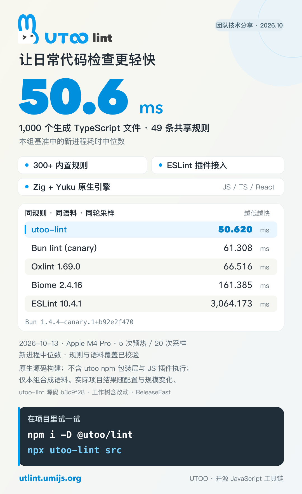

给大家介绍一下 **utoo-lint**：用 Zig 编写、基于 Yuku 的 JavaScript / TypeScript Linter。内置 300+ 规则，覆盖 React、TypeScript、import 和 JSX 无障碍检查；支持 ESLint 插件接入、自动修复和类型化配置。

性能先看一组可复现数据：在 10 月 13 日的本地基准中，原生 CLI 检查 **1,000 个生成的 TS 文件、49 条共享规则，中位数 50.62 ms**。测试使用 Apple M4 Pro，不含 utoo npm 启动包装层，完整条件与工具版本见配图和[介绍](./intro.zh-CN.md)。



安装后就能在项目中试用：

```bash
npm install --save-dev @utoo/lint
npx utoo-lint src
```

现阶段可以先从已覆盖的规则开始，与现有 ESLint 对照诊断结果，再逐步接入项目。社区插件通过 Node 执行，依赖类型信息的规则、定制解析器和处理器仍需保留原有流程。

[中文文档](https://utlint.umijs.org/zh-CN/) · [在线 Playground](https://utlint.umijs.org/playground/) · [GitHub](https://github.com/utooland/utoo-lint)
